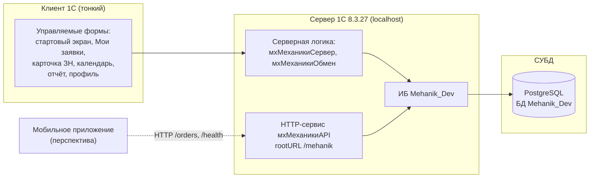
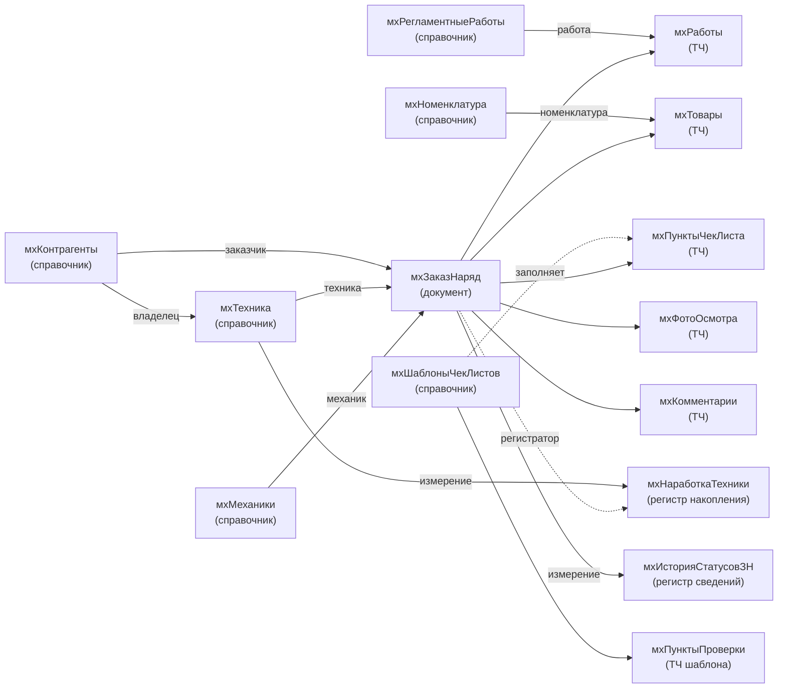
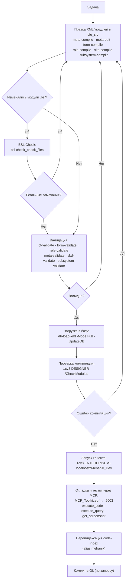

# ИСТК Механики — прототип мобильного приложения механиков

Мобильное приложение для механиков сервисной службы ИСТК, работающее в связке с учётной
системой 1С. Реализовано как **управляемая конфигурация 1С** (прототип, с прицелом на
адаптацию под мобильный клиент). Основание — презентация «Приложение ИСТК Механики, комм ММА»
и [ТЗ.md](ТЗ.md).

- Конфигурация: `ИСТК_Механики` (префикс имён объектов — `мх`)
- Платформа: 1С:Предприятие 8.3.27.2214
- Исходники: `cfg_src` (XML-выгрузка)
- Базы: серверная `localhost\Mehanik_Dev` (PostgreSQL) и файловая `E:\file_bases\Mehanik_Dev`

## 1. Назначение и возможности

- Получение и обработка заявок на ремонт и ТО строительной техники с телефона.
- Пошаговое выполнение работ: выезд → диагностика → ремонт → тестирование → сдача машины.
- Чек-листы осмотра и регламентных работ ТО, фотофиксация, подпись клиента.
- Приём запасных частей на складе с подтверждением получения.
- Учёт реальной наработки (моточасы / пробег) и отчёт по отработанным нормо-часам.
- Двусторонний обмен с 1С (заготовка HTTP-сервиса).

## 2. Архитектура



Роли:

| Роль | Права |
|------|-------|
| `мхМеханик` | Работа с ЗН, просмотр справочников, чтение регистров и отчёта |
| `мхРуководитель` | Полное редактирование справочников и ЗН, чтение отчёта |
| `мхАдминистратор` | Полные права на всё, **кроме интерактивного удаления** |

## 3. ER-диаграмма (сущность — связь)



### 3.1. Ключевые сущности и реквизиты

**Документ `мхЗаказНаряд`** (регистратор наработки; 5 табличных частей)

| Реквизит | Тип | Назначение |
|----------|-----|-----------|
| `мхСтатус` | `EnumRef.мхСтатусыЗН` | Статус ЗН (План … Закрыт) |
| `мхВидРабот` | `EnumRef.мхВидыРабот` | ТО / Заявка / Гарантия / ППП |
| `мхТехника` | `CatalogRef.мхТехника` | Обслуживаемая техника |
| `мхЗаказчик` | `CatalogRef.мхКонтрагенты` | Заказчик |
| `мхМеханик` | `CatalogRef.мхМеханики` | Исполнитель |
| `мхДатаВремяРемонта` | `Date` | Дата/время ремонта |
| `мхМестоположение` | `String` | Стационар / адрес выезда |
| `мхКонтактноеЛицо`, `мхТелефонКонтактногоЛица` | `String` | Контакт на объекте |
| `мхМенеджер`, `мхТелефонМенеджера` | `String` | Менеджер |
| `мхПричинаОбращения` | `String` | Причина обращения |
| `мхНаработкаЗаявкиМоточасы` / `…Пробег` | `Number` | Наработка заявки (м/ч, км) |
| `мхНаработкаВизитаМоточасы` / `…Пробег` | `Number` | Наработка на дату визита |
| `мхВозможностьЭксплуатации` | `EnumRef.мхВозможностьЭксплуатации` | Дальнейшая эксплуатация |
| `мхПодписьФИО`, `мхПодписьДолжность`, `мхПодписьПолучена` | `String`/`Boolean` | Подпись клиента |

Табличные части: `мхРаботы` (Работа, Наименование, Выполнено, Нормочасы),
`мхТовары` (Номенклатура, Количество, КоличествоПринятоНаСкладе, ПолученоНаСкладе, Использовано),
`мхПунктыЧекЛиста` (Пункт, Блок, Результат, КомментарийДефекта),
`мхФотоОсмотра` (ТипФото, Комментарий, ЕстьФото),
`мхКомментарии` (Дата, Автор, Текст).

**Справочники**

| Объект | Ключевые реквизиты |
|--------|--------------------|
| `мхТехника` | Модель, Бренд, VIN, Госномер, ТекущаяНаработка (м/ч, км), Владелец |
| `мхКонтрагенты` | ИНН, Адрес, КонтактноеЛицо, Телефон |
| `мхМеханики` | Телефон, Email, ЗакрепленнаяТехника |
| `мхНоменклатура` | Артикул, ЕдиницаИзмерения, Цена |
| `мхРегламентныеРаботы` | Блок, Нормочасы, ВидТО |
| `мхШаблоныЧекЛистов` | ВидТехники; ТЧ `мхПунктыПроверки` |

**Регистры**

| Объект | Тип | Измерение | Ресурсы |
|--------|-----|-----------|---------|
| `мхНаработкаТехники` | Накопления (Обороты) | Техника | Моточасы, Пробег |
| `мхИсторияСтатусовЗН` | Сведений (периодичность — секунда) | ЗаказНаряд | Статус |

**Перечисления**

| Объект | Значения |
|--------|----------|
| `мхСтатусыЗН` | План, Подготовка, Выехал, Доехал, ОжиданиеТехники, ПриступилКРаботе, Приостановка, Закончил, Закрыт |
| `мхВидыРабот` | ТО, Заявка, Гарантия, ППП |
| `мхРезультатыПроверки` | Исправно, Неисправно, ТребуетВнимания |
| `мхВозможностьЭксплуатации` | Рекомендована, НеРекомендована |

## 4. Блок-схема работы с конфигурацией



## 5. Интерфейс (экраны)

| Экран | Реализация | Слайды ТЗ |
|-------|-----------|-----------|
| Стартовый экран | `ОбщаяФорма.мхНачальныйЭкран` (плитки, NEXCLOUD, профиль) — назначен начальной страницей (`HomePageWorkArea`) | Начальный экран |
| Мои заявки | `Документ.мхЗаказНаряд.ФормаСписка` — динамический список, цветовая маркировка (серый/зелёный/жёлтый), флажок «Только новые» | Мои заявки |
| Карточка ЗН | `Документ.мхЗаказНаряд.ФормаДокумента` — вкладки: Информация, Работы, Товары, Чек-лист, Фото, Подпись | Карточка ЗН |
| Календарь | `ОбщаяФорма.мхКалендарь` — календарь месяца + заявки на дату | Календарь |
| Отчёт по н/ч | `Отчет.мхОтработанныеНормочасы` (СКД, параметр «Отчётный месяц», итог нормочасов) | Отчёт |
| Тех. литература | `ОбщаяФорма.мхТехЛитература` — ссылка на NEXCLOUD | Тех. литература |
| Профиль | `ОбщаяФорма.мхПрофиль` — ФИО, контакты, техника, уведомления, выход | Профиль |

## 6. Интеграция с 1С (заготовка)

HTTP-сервис `мхМеханикиAPI` (`rootURL = mehanik`):

| Шаблон URL | Метод | Обработчик |
|------------|-------|-----------|
| `/orders` | GET | `ЗаказыGet` — список заявок механика |
| `/orders` | POST | `ЗаказыPost` — приём результатов ЗН |
| `/health` | GET | `ЗдоровьеGet` — проверка доступности |

Общий модуль `мхМеханикиОбмен`: точки входа `ПолучитьЗаявкиМеханика`, `ПередатьРезультатыЗаказНаряда`.

## 7. Окружение и команды

| Что | Значение |
|-----|----------|
| Исходники | `E:\project\mp_mehanik\cfg_src` |
| Платформа | `C:\Program Files\1cv8\8.3.27.2214\bin` |
| Серверная база | `localhost\Mehanik_Dev` (PostgreSQL, user `postgres`) |
| Файловая база | `E:\file_bases\Mehanik_Dev` |
| Реестр баз | `.v8-project.json` (по умолчанию — серверная `test`) |
| MCP | `code-index` (alias `mehanik`); `mcp-1c` через `MCP_Toolkit.epf` (порт 6003) |

Типовой цикл:

```powershell
# BSL Check изменённых модулей
bsl-check_check_files -Files "<module.bsl>"

# Загрузка исходников в базу с обновлением БД
db-load-xml.ps1 -V8Path "C:\Program Files\1cv8\8.3.27.2214\bin" `
  -InfoBaseServer localhost -InfoBaseRef Mehanik_Dev `
  -ConfigDir "E:\project\mp_mehanik\cfg_src" -Mode Full -UpdateDB

# Проверка компиляции модулей
1cv8.exe DESIGNER /S "localhost\Mehanik_Dev" /CheckModules /Out check.txt /DisableStartupDialogs

# Запуск клиента
1cv8.exe ENTERPRISE /S "localhost\Mehanik_Dev"
```

## 8. Правила проекта

- **BSL Check** после каждого изменения модуля (см. [AGENTS.md](AGENTS.md), Правило 1).
- Префикс новых имён — `мх`.

## 9. Открытые вопросы (из ТЗ)

1. Учёт дополнительных работ (в приложении есть добавление, механизм в 1С — «на подумать»).
2. Способ занесения регламентных работ/чек-листа в 1С и автоподгрузка по виду техники.
3. Состав и формат отчёта для производителя.
4. Целевые мобильные платформы и офлайн-синхронизация.
5. Модуль подписи (по образцу ДЧЛ), скан и печатная форма полевого ЗН.
